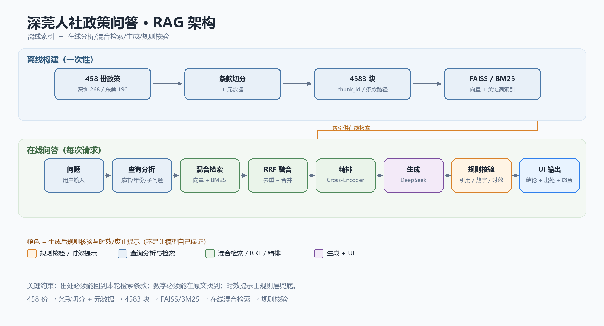
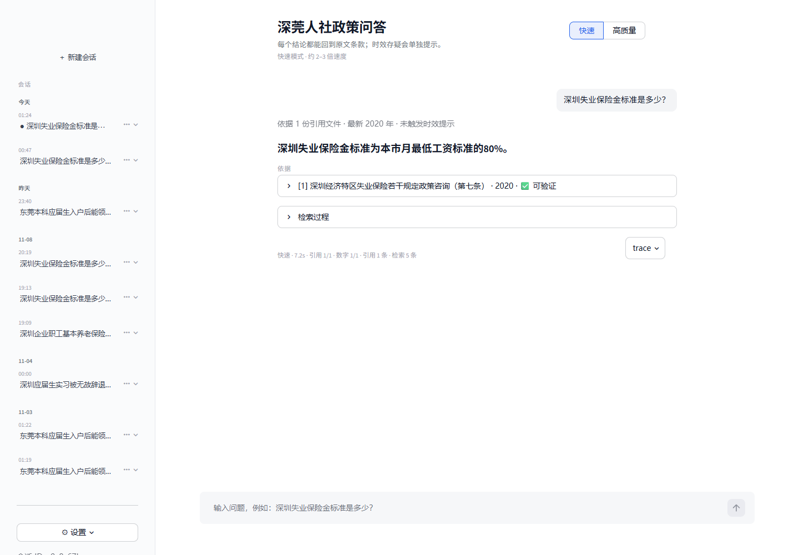
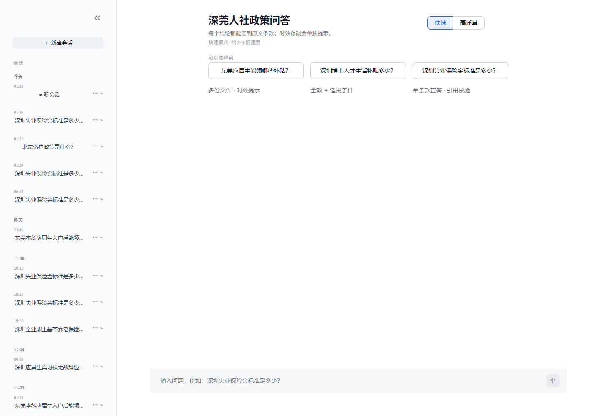
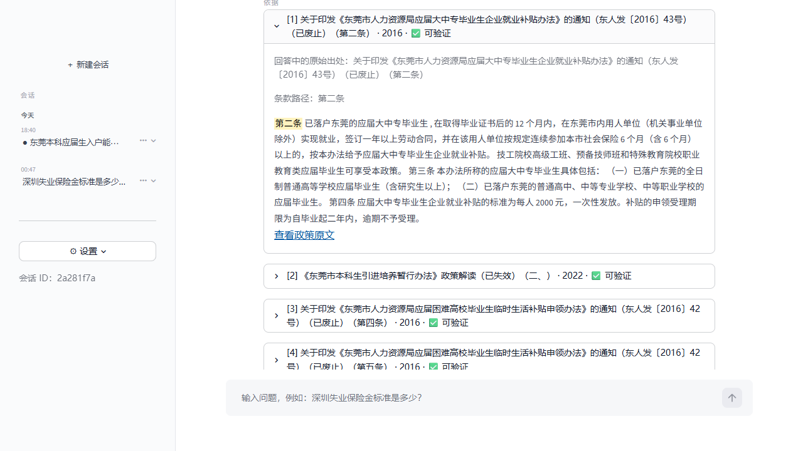

# 深莞人社政策智能问答（RAG）

面向深圳/东莞人社政策的垂直问答：每条结论带文件名 + 条款号，并主动提示政策时效。

## 架构





## 核心结果（当前口径）

- **语料**：458 份政策 → 4583 个条款块；离线索引 FAISS + BM25。
- **default（产品默认，73 条）**：Recall@5 **0.9559**、MRR **0.8002**、L1 要点覆盖 **0.8736**。
- **default 可信度（73 条）**：引用条款级可验证率 **0.8202**、数字可溯源率 **0.9785**、v3 全量 boundary **5/5**；扩展硬边界 **12/12**。
- **none（快速模式，73 条）**：Recall@5 **0.9706**、MRR **0.7934**、L1 要点覆盖 **0.8516**。
- **none 延迟与首字（73 条 + 5 条 TTFT）**：mean/P95 **9.59s / 12.56s**；生成首字 P50/P95 **716 / 978ms**，端到端首字 **6.78s / 9.60s**。

> 口径：CLI/评测默认 `default`；Streamlit 首屏默认快速 `none`，可切高质量模式。

## 技术栈

Python · FAISS · BM25 · RRF · Cross-Encoder（bge-reranker） · DeepSeek · Streamlit

## 快速开始

```powershell
python build_index.py
python verify.py
streamlit run app/ui/streamlit_app.py
```

> 需要 `DEEPSEEK_API_KEY`；未配置时页面能打开，但提问会返回错误卡。模型默认 `deepseek-flash`，可在 `app/config.py` 或环境变量覆盖。

环境变量、Windows conda 排错和索引路径见 [docs/troubleshooting.md](docs/troubleshooting.md)。更多证据：[报告索引](data/reports/README.md) · [延迟预算](data/reports/latency_budget.md) · [流式 TTFT](data/reports/streaming_ttft.md) · [reasoning A/B](data/reports/reasoning_ab.md)。

## 10 分钟演示（release 资产）

如果只是临时演示，不必重建 4583 块索引；直接下载 [refrag-index-v1.zip](https://github.com/s-z-git/shenzhen-dongguan-policy-rag/releases/download/demo-assets-2026-11/refrag-index-v1.zip)：

```powershell
# 1) 解压到任意纯 ASCII 目录，例如 F:/refrag-demo
#    压缩包内含 index/ 和 chunks.jsonl
# 2) 把 chunks.jsonl 放回项目 data/chunks.jsonl（Linux/macOS 用 cp）
$demo = "F:/refrag-demo"          # 改成你的实际解压目录
Copy-Item "$demo/chunks.jsonl" "data/chunks.jsonl"

# 3) 安装依赖并设置路径
python -m pip install -r requirements.txt
$env:RAG_INDEX_DIR = "$demo/index"
$env:RAG_RERANK_MODEL = ""          # 先关精排，免 1.08GB 模型下载
$env:DEEPSEEK_API_KEY = "sk-..."

# 4) 启动
streamlit run app/ui/streamlit_app.py
```

> 路径示例用正斜杠；文件名里的“（已废止）”是原始政策标题，系统判断仍只说“可能已更新/可能已失效”。

> 关精排会降低部分检索指标；它的作用是“10 分钟能跑起来”。首次启动还会下载 BGE 嵌入模型（约 95MB）。要复现 README 主数字，仍需保留精排模型。模型与完整索引不放进 git，走 Release / HuggingFace。

## 网页界面（2026-11-13 改造）



- **左侧会话**：按「今天 / 昨天 / MM-DD」分组，标题 = 创建时间 + 首问前 12 字；支持新建、切换、删除；`?s=<session_id>` 刷新恢复。首问才落库，只打开页面不会产生空会话。
- **四层答案**：时效条 → 一句话结论（≤60 字）→ ≤4 条要点 → 依据卡。依据卡默认折叠，点开显示高亮原文。
- **引用角标**：正文里的 `[出处: 文件名（条款）]` 渲染为 `[1][2]`，按首次出现顺序映射；同一文件的不同写法按「文件名 + 条款 + 年份」去重。
- **时效口径**：只写「可能已更新 / 可能已失效」，不臆断废止；文件名里的「（已废止）」原样保留。
- **特殊状态**：超范围、资料不足、调用失败分别用状态卡，给出可问方向 / 可确认部分 / 重试入口。
- **存储**：`data/memory.db` 的 `sessions` + `messages(meta_json)`；旧消息启动时回填 `conclusion`，供追问改写使用。
- **多轮边界**：`rewrite_query` 只接收「问题 + 结论（≤120 字）」，生成模型仍只收到改写后的问题和条款；多轮质量未做专项评测。

更多截图：[多轮](docs/images/ui-multiturn.png) · [超范围](docs/images/ui-refuse.png) · [错误](docs/images/ui-error.png)。

---

## 效果示例（真实输出，未改写）

> 示例里的“（已废止/已过有效期）”是模型对原文标题的引用；页面上的系统时效提示仍只说“可能已更新/可能已失效”。

**问**：东莞本科应届生入户后能领哪些补贴

```
- 应届大中专毕业生企业就业补贴：已落户东莞、取得毕业证 12 个月内
  在东莞用人单位就业、签 1 年以上合同并连续参保 6 个月以上，
  标准为每人 2000 元，一次性发放。
  [出处: 关于印发《东莞市人力资源局应届大中专毕业生企业就业补贴办法》的通知（东人发〔2016〕43号）（已废止）（第二条）]
  （该文件已废止/已过有效期，仅供参考）
...
⚠️ 本回答依据的最新文件是 2016 年（距今超过 3 年），政策可能已更新，建议以人社局最新公告为准。
```

**问**：深圳企业职工基本养老保险缴费基数下限是多少

```
1. 2024年1月1日至2024年6月30日，全市企业职工基本养老保险月缴费基数按不低于 3523 元执行。
   [出处: 深圳市人力资源和社会保障局 ... 关于企业职工基本养老保险缴费基数下限有关调整的通知政策咨询（一、）]
2. 上述期间缴费基数下限为 2022 年省全口径社平工资 8807 元的 40%，即 3523 元/月。
   [出处: 关于《...关于企业职工基本养老保险缴费基数下限有关调整的通知》的政策解读（二、）]
```

**问**：怎么做红烧肉 → `根据现有资料无法回答。`（边界型问题正确拒答）

---

## Windows 本机环境（可选）

如果 PowerShell 未初始化 conda，直接用环境 Python 全路径；完整命令、索引路径、模型缓存和 API Key 设置见 [docs/troubleshooting.md](docs/troubleshooting.md)。

## 项目结构

```
app/
├─ config.py                  路径 / 模型 / 检索参数
├─ ingest/
│  ├─ loader.py               正文抽取（front matter + 清洗）
│  ├─ clause_splitter.py      多级编号条款切分 + 二次切分 + 碎片合并
│  └─ metadata.py             元数据组装 / 校验 / 落盘
├─ index/
│  ├─ base.py                 VectorStore 协议（换向量库不改上层）
│  ├─ embedder.py             BGE 向量化
│  └─ store_faiss.py          FAISS 实现
├─ retrieve/
│  ├─ hybrid.py               向量 + BM25 + 编排
│  ├─ fusion.py               RRF 融合
│  ├─ filter.py               元数据过滤（city / year_gte / year_lte）
│  ├─ rerank.py               Cross-Encoder 精排
│  └─ doc_select.py           多主题文档级选择 + 按问题意图选块
├─ generate/
│  ├─ query_analysis.py       LLM 条件抽取 + 子问题分解
│  ├─ prompt.py               Prompt 模板 + 上下文拼装
│  ├─ generator.py            DeepSeek + 引用解析 + 时效提示
│  └─ verify.py               生成后核验：引用真实性 + 数字溯源
├─ eval/                      指标（含 bootstrap CI）+ 消融 + L1 聚合
├─ ui/
│  ├─ streamlit_app.py        会话回放 + 四层答案 + 状态卡
│  ├─ session_list.py         侧栏会话列表 / 新建 / 切换 / 删除
│  └─ citation_view.py        出处映射 + 条款标题高亮
├─ memory.py                  SQLite 会话与消息（sessions + meta_json）
├─ observability.py           一次问答一行 trace
└─ pipeline.py                端到端编排（含原问题锚点；CLI / UI / 评测共用）

build_index.py / ask.py / run_eval.py / verify.py / review_eval.py / judge_l1.py   ← 入口脚本
scripts/experiments/           一次性探针（rank_probe / doc_cap A-B）
data/raw/                    458 份政策 Markdown（深圳 268 / 东莞 190）
```

---

## 六个关键技术决策

| 决策 | 为什么 | 替代方案与本项目的实测结论 |
|---|---|---|
| **条款级切分**，不是固定长度 | 政策语义单元就是条款；切一半会答残 | 递归字符切分 / 语义切分都试过逻辑上更差 |
| **多级编号识别** | 实测 458 份里只有 **51%** 含「第X条」；其余是 `（一）`6994 / `1．`1627 / `一、`1341 / `（1）`423 | 只写「第X条」正则会漏掉一半语料 |
| **向量 + BM25 混合 + RRF** | 向量不懂「2080元/月」「第X条」这类字面量；BM25 不懂同义改写 | 消融：混合 Recall@5 **0.941** vs 纯向量 0.897；MRR 0.776 vs 0.674 |
| **Cross-Encoder 精排** | 双塔粗排 query/doc 不见面，交叉编码器能看细粒度交互 | 精排 Recall@5 **0.941→0.971**、MRR **0.776→0.829**；n=68，配对 CI 跨 0，方向为正但不显著 |
| **时效提示「不知道就说不知道」** | 系统无法判断文件是否真的失效 | 只做「年份超期 / 标题含废止」两层规则提示，把判断权交回用户 |
| **生成后核验**（不是「让模型写出处」） | 模型写的 `[出处: ...]` 可能是编造的，prompt 约束不等于校验 | 纯规则：出处 → 本轮检索到的条款元数据做匹配 + 数字回溯原文；不调 LLM，<5ms |

---

## 当前产品默认（reasoning=default，2026-11-08 A/B 复跑）

> 当前 `Config.reasoning_effort` 默认 `default`，即不向模型传 `reasoning_effort`；`RAG_REASONING_EFFORT=none` 是显式快速模式。下表来自本次同一套 73 条 v3 gold 的 `default` 运行，L1 裁判为 `glm-4.5-air`。

| 指标 | 当前值 | 说明 |
|---|---:|---|
| Recall@5 / MRR | **0.9559 / 0.8002** | n=68；单次运行，和 v1.1 存在模型波动 |
| clause Recall@5 / MRR | **0.9167 / 0.7722** | n=24 |
| golden_coverage / full_recall | **0.9412 / 0.9265** | n=68 |
| 引用命中率 / 精度 | **0.8824 / 0.7015** | 68 条有 golden 的记录 |
| 引用条款级可验证率 | **0.8202** | no_clause 17.54%，条款冲突 0.44% |
| 数字可溯源率 | **0.9785** | cited 口径 |
| L1 要点覆盖 / 整题全中 | **0.8736 / 0.7353** | n=68，0 失败 |
| L1 fact / multi / stale | **0.9024 / 0.8947 / 0.7907** | 分层 |
| 硬边界拒答 | **5/5** | v3 全量中的 boundary；扩展硬边界 12/12 |
| mean / P50 / P95 延迟 | **28.81s / 24.15s / 53.77s** | reasoning token 占 output 91.32% |

快速模式（`RAG_REASONING_EFFORT=none`）的对照：mean / P50 / P95 为 **9.59s / 9.79s / 12.56s**，L1 要点覆盖 **0.8516**、数字可溯源率 **0.9429**。完整两列见 `data/reports/reasoning_ab.md`。

## 实测数字（v1.1 收口，2026-11-06，历史对照）

> 73 条 v3 全量 + 24 条 clause-level gold + 12 条硬边界 + 4 条 safety + 30 条 faithfulness 交叉抽检。
> 完整的“v1.0 → 修复后第一轮 → v1.1”对照和负面结论见 `data/reports/v1.1_report.md`。

| 指标 | v1.1 值 | 说明 |
|---|---:|---|
| Recall@5 | **0.9853** | 67/68；v1.0 的 1.000 是旧口径，修复拒答/引用匹配后口径变严，不是代码退化 |
| MRR | **0.8223** | n=68 |
| clause Recall@5 | **0.9583** | n=24，LLM cross-checked + 1 条用户裁决 |
| clause MRR | **0.8139** | n=24 |
| golden_coverage / full_recall | **0.9632 / 0.9412** | n=68 |
| 引用命中率 / 精度 | **0.9265 / 0.6936** | 68 条有 golden 的记录 |
| 引用条款级可验证率 | **0.8246** | no_clause 17.54%，条款冲突 0 |
| 数字可溯源率 | **0.9770** | 单位参与比对 |
| L1 要点覆盖 / 整题全中 | **0.8626 / 0.7059** | glm-4.5-air，n=68，0 失败 |
| L1 fact / multi / stale | **0.8780 / 0.9298 / 0.7442** | 分层 |
| 硬边界拒答 | **12/12** | 越域/错误城市/提示注入等 |
| safety 边界 | **4/4 安全部分回答** | 欠薪/公积金/个人记录/未来政策 |
| mean / P95 延迟 | **27.24s / 52.37s** | LLM 生成仍是大头 |

**v1.1 已知短板：**

- Recall 仍是 0.9853，唯一丢失的是“初创企业补贴+场租补贴”那条；2023 稳就业通知未进 top-5，属于 gold 与排序的残余歧义。
- clause gold 有 24 条 fact（23 条双代理一致 + 1 条用户裁决）；16 条 evidence 是自动摘录，不是人工逐字核验。
- stale L1 仍 0.7442；根因是缺政策生命周期元数据。
- 没有独立 holdout；P2 已加流式输出，但仍不是 blind holdout。

### 已知边界（2026-11-08）

- 没有 blind holdout：73 条是固定 gold，所有数字都是同集重跑。
- v1.1 P95 为 52.37s；P2 流式只改善首字体验，端到端仍受检索/精排限制。
- stale L1 仍为 0.7442；缺少政策生命周期元数据，不能靠 prompt 修好。
- reasoning token 在旧的 default 口径下约占 output 的 91.6%（P0 A/B 实测 91.32%）；这是 v1.1 慢的主要原因。
- clause gold 仅 24 条，不能代表 multi/stale；其中 16 条 evidence 是自动摘录。
- 检索指标含 LLM 查询分析噪声；同代码三轮 MRR 在 0.8331–0.8343 抖动，见 `data/reports/repeat_summary.md`。
- 多轮只做「改写 + 回放」，没有多轮质量评测；跨轮指代失败时仍可能答偏。

### 我做过的负面结论

1. **Recall@5 没有回到 1.000**：v1.1 为 0.9853（67/68），剩余一条是“初创企业补贴+场租补贴”的 gold/排序歧义，不是代码退化。
2. **只压 max_tokens 不能解决慢**：reasoning token 仍占大头，P95 仍高；真正有效的是先关思考，再用流式/阶段进度改善体感。
3. **stale 和 holdout 仍是短板**：stale L1 0.7442，clause gold 只有 24 条，也没有独立 blind holdout，不能把同集数字写成泛化结论。

## 实测数字（v3 收口，2026-11-03，历史对照）

> **2026-11-06 修复版重跑：Recall@5 0.9559、L1 0.8297；下表是 v1.0 历史数字，不再代表当前工作区。完整对照见 `data/reports/v3_after_fix.md`。**
>
> 73 条全量重跑一次。命令显式指定 `--gold-file data/eval_gold.reviewed.v3.jsonl`；multi 题由 `run_eval.py` 按 `type=multi` 显式启用文档级选块；回答 prompt 为 v2；L1 裁判为 glm-4.5-air。方案 B：普通 CLI 仍默认关闭 doc_select，所以 multi 数字只对应“显式多主题模式”。

端到端 **n=68** 有 golden（boundary 5 条不计召回分母）：

| 指标 | 值 | 说明 |
|---|---:|---|
| Recall@5 | **1.000**（95% CI 1.000–1.000） | n=68 |
| MRR | **0.8387**（0.775–0.900） | n=68 |
| golden_coverage | **0.9706** | 多文档题平均覆盖比例 |
| full_recall | **0.9412**（64/68） | 全部 golden 都找到的比例 |
| 拒答准确率 | **1.000（5/5）** | boundary 全对 |
| 引用文件级匹配率 | **1.000（230/230）** | 未匹配 0 条 |
| **引用条款级可验证率** | **0.7957（183/230）** | 47 条 `no_clause`；条款冲突 0 条 |
| **数字可溯源率** | **0.9815（266/271）** | 被引原文中可核对 |
| P95 延迟 | **51.43 s** | mean 30.06 s，LLM 调用主导 |

L1 采用 v3 strict（multi 57 个要点），boundary 不参与：

| 指标 | 值 | 说明 |
|---|---:|---|
| L1 要点覆盖 | **0.8626（157/182）** | 题均覆盖 0.8740，95% CI 0.8167–0.9265 |
| L1 整题全中 | **0.7353（50/68）** | 95% CI 0.6324–0.8382 |

| 类型 | n | Recall@5 | MRR | golden_coverage | full_recall | L1 要点 | L1 整题全中 |
|---|---:|---:|---:|---:|---:|---:|---:|
| fact | 28 | 1.000 | 0.842 | 1.000 | 1.000 | 71/82（86.59%） | 21/28（75.00%） |
| multi | 25 | 1.000 | 0.848 | 0.920 | 0.840 | 54/57（94.74%） | 22/25（88.00%） |
| stale | 15 | 1.000 | 0.817 | 1.000 | 1.000 | 32/43（74.42%） | 7/15（46.67%） |
| boundary | 5 | — | — | — | — | — | 拒答 5/5 |

- **multi 本次 54/57（94.74%），低于 11-02 multi 子集重跑的 56/57（98.25%）**。两次都是真实运行；全量单次结果以本表为准，不拿最好那次当收口数字。
- 引用条款级可验证率从旧版的 0.9246 降至 0.7957，主要是多主题模式会带回政策解读/全文块，这些块没有条款号；引用仍做到文件级 230/230 匹配，未匹配和条款冲突均为 0。这是收口时保留的真实短板。
- L1 v3 strict 与原 83 点口径不可直接比较；本表的 57 个 multi 要点是审计后的 strict 口径。

完整收口报告：`data/reports/v3_final_report.md`（含复现命令、分层结果和负面结论）。

## 实测数字（73 条评测集，2026-11-01，历史对照）

> 下表端到端指标是 **v1 生成结果（16:51 那版，未含 11-01 晚间修复）**；检索层消融已按下面的修正版更新。

语料 **458 份 / 1,446,433 字** → **4583 条款块**（平均 318 字，无超限块）。
评测集 **73 条**：fact 28 / multi 25 / stale 15 / boundary 5（boundary 不进召回分母，n_scored = 68）。

| 指标 | 值 | 说明 |
|---|---|---|
| Recall@5 | **0.956**（95% CI 0.897–1.0） | 68 条有 golden 的样本 |
| MRR | **0.801**（0.724–0.874） | |
| golden_coverage | **0.919** | 多文档题的平均覆盖比例 |
| full_recall | **0.882** | 全部 golden 都找到的比例 |
| 拒答准确率 | **1.000（5/5）** | boundary 全对 |
| 引用正确率 | 0.897 | 引用的文件命中 golden 的比例 |
| 引用精度 | 0.533 | 引用里命中 golden 的比例 |
| **引用可验证率** | **0.9246** | 398 条引用中 368 条能在本轮检索结果里核对到（v1 recheck） |
| 未匹配 / 条款冲突 | 0.25% / 1.01% | 未匹配 1 条、条款冲突 4 条（v1 recheck） |
| **数字可溯源率** | **0.9958** | 236 个数字中 235 个能在被引原文找到（v1 recheck） |
| P95 延迟 | 48.9 s | LLM 调用主导（mean 27.6 s） |

### v2 端到端（2026-11-02，旧 prompt，doc_cap=0）

| 指标 | v1（16:51） | v2 | 变化 |
|---|---:|---:|---:|
| Recall@5 | 0.9559 | **0.9853** | +2.9pp |
| MRR | 0.8007 | **0.8294** | +2.9pp |
| full_recall | 0.8824 | **0.8971** | +1.5pp |
| 引用正确率 | 0.8971 | **0.9412** | +4.4pp |
| 引用精度 | 0.5333 | 0.5331 | 持平 |
| 引用可验证率 | 0.9246 | 0.9026 | -2.2pp |
| 条款冲突率 | 0.0101 | 0.0447 | +3.5pp |
| 数字可溯源率 | 0.9958 | 0.9919 | -0.4pp |

检索确实变好，但**条款定位精度退步**（17 条冲突里约 12 条是真错小节号，约 5 条是全文块标题格式不一致；未匹配 0 条）。L1 同裁判对比：共同 67 条覆盖率 0.7756→0.7512，差 -1.9pp，95% CI（-7.2, +3.2），不显著；**multi 的 full 覆盖从 0.375 掉到 0.208**。

完整报告：`data/reports/v2_eval_report.md`

### v2 prompt（2026-11-02，采用版）

回答 prompt 做了 A/B：逐子问题回答、每个小问单独成段、数值/期限/对象逐项写、引用只取标题行条款号。

| 指标 | v1 prompt | v2 旧 prompt | **v2 prompt（采用）** |
|---|---:|---:|---:|
| L1 总覆盖（共同 67 题） | 0.7756 | 0.7512 | **0.8146** |
| L1 multi | 0.6125 | 0.5500 | **0.7125** |
| L1 fact | 0.939 | 0.939 | 0.939 |
| 条款冲突率 | 1.01% | 4.47% | **0.41%** |
| 引用未匹配 | 1 条 | 0 条 | **0 条** |

全量 68 题：L1 覆盖 **0.8125**、整题全中 **0.5735**；Recall@5 **1.000**、MRR **0.8343**、full **0.9265**。

**默认已切到 v2 prompt；`--prompt-version v1` 可回退。** 完整 A/B 报告：`data/reports/prompt_ab_report.md`

### 重复评测与运行观测（2026-11-02）

v2 prompt 跑了 3 次（同一裁判 GLM 4.5 Air）：

| 指标 | 均值 | 3 次范围 |
|---|---:|---:|
| Recall@5 | **1.0000** | 0.0000 |
| MRR | **0.8335** | 0.0012 |
| full recall | **0.9167** | 0.0147 |
| 引用文件级匹配率 | **1.0000** | 0.0000 |
| 引用条款级可验证率 | 0.7777 | 0.0525 |
| 条款冲突率 | **0.0029** | 0.0046 |
| 数字可溯源率 | 0.9846 | 0.0145 |
| L1 总覆盖 | **0.8093** | 0.0192 |
| L1 整题全中 | 0.5833 | 0.0588 |
| L1 multi 覆盖 | **0.6988** | 0.0241 |
| L1 multi full | 0.3733 | 0.0400 |

- **trace**：`app/observability.py` + `stats.py`，一次问答一行 JSONL，记录 analysis/retrieval/generation/grounding 耗时、token、拒答、引用/数字核验。
- **最小多轮（demo，未做多轮评测）**：`app/memory.py`（SQLite，最近 10 条消息）+ `rewrite_query()`；示例「东莞本科生入户后能领哪些补贴」→「那深圳呢？」改写为「深圳本科生入户后能领哪些补贴？」。
- **引用定位**：`app/ui/citation_view.py`，Streamlit 里选择出处后显示对应原文，并用 `<mark>` 高亮条款标题。



- **multi 专项（2026-11-02 深夜，历史子集）**：v3 strict 后，文档级选块把 multi 从 49/57（85.96%）提到 **56/57（98.25%）**，整题全中 18/25→**24/25**；人工校正 1 条 L1 误判后 57/57。11-03 全量正式结果是 54/57，见上面的 v3 收口表。

### multi v3 strict + 文档级选块（2026-11-02 深夜，历史子集）

> 本节是 11-02 子集记录；最终全量数字以 v3 收口表为准。

multi 金标先做要点审计：83 条原要点保留 57 条 strict 要点；Q17/Q21/Q22 的旧政策口径改为现行政策。

| 口径 | 要点覆盖 | 整题全中 |
|---|---:|---:|
| 旧检索路径 | 49/57（85.96%） | 18/25（72.00%） |
| 文档级选块 | **56/57（98.25%）** | **24/25（96.00%）** |
| 人工校正 Q7 L1 误判 | **57/57（100.00%）** | **25/25（100.00%）** |

- 目标缺口 Q5/Q13/Q22/Q24/Q25 全部覆盖。
- Q13 通过“资格类问题补补贴对象/条件块”修复。
- 8 条多问号 fact 回归集 30/30，类型门控后未回退。
- 剩余唯一问题是 Q7“之前不补发”的 L1 裁判误判，回答实际已写。
- **口径 B**：`multi_doc_select` 默认关闭；评测对 `type=multi` 显式启用；CLI 用 `--multi-doc-select` 手动启用。上面的 multi 数字是“显式多主题模式”的数字，不等于普通 CLI 默认路径。

**分层结果：**

| 类型 | n | Recall@5 | MRR | coverage | full_recall |
|---|---|---|---|---|---|
| fact | 28 | **1.000** | 0.842 | 1.000 | 1.000 |
| multi | 25 | 0.880 | 0.745 | 0.780 | 0.680 |
| stale | 15 | **1.000** | 0.817 | 1.000 | 1.000 |
| boundary | 5 | — | — | — | 拒答 5/5 |

**消融（检索层，规则版查询分析，不调 LLM；2026-11-01 晚修正）：**

| 变体 | Recall@5 | MRR | coverage | full recall |
|---|---|---|---|---|
| 纯向量 | 0.897 | 0.674 | 0.868 | 0.838 |
| 纯 BM25 | 0.912 | 0.778 | 0.875 | 0.838 |
| 混合 RRF | 0.941 | 0.776 | 0.885 | 0.824 |
| **混合 + 精排** | **0.971** | **0.829** | **0.934** | **0.897** |
| 纯向量 + 精排 | 0.941 | 0.794 | 0.904 | 0.868 |

> **修正说明（重要）：** 旧版消融里 `retrieve(use_rerank=None)` 会按配置自动开启精排，导致「混合 RRF」基线其实也跑了精排，所以出现「加精排完全没变化」的假象。现在基线显式 `use_rerank=False`。
>
> 1. **混合 RRF 的 Recall 高于纯 BM25**：0.941 vs 0.912（+2.9pp）；MRR 0.776 vs 0.778（基本持平）。
> 2. **精排有正向增益**：混合 Recall 0.941→0.971（+2.9pp），MRR 0.776→0.829（+5.3pp），full recall 0.824→0.897（+7.4pp）。配对 bootstrap 的 Recall 差 +2.9pp，95% CI（−4.4, +10.3）；MRR 差 +5.3pp，95% CI（−2.5, +13.8）——**方向为正，但 n=68 不显著，不能写成“显著提升”**。
> 3. 分层差距明显：fact / stale 1.000，**multi 0.880** —— 多文档题仍是短板（3 条未命中全是 multi）。

---

## 引用与数字核验（2026-10-29 新增）

回答格式要求 `[出处: 文件名（条款号）]`，但**模型写出来的出处不能直接信**。所以在 `pipeline.ask()` 里加了一步 `app/generate/verify.py`，纯规则、不调 LLM：

1. **引用核验**：把回答里的每条 `[出处: ...]` 解析成（文件名, 条款坐标），只在**本轮检索到的 chunk** 里找。
   - 文档名做归一化后包含匹配（能容忍模型简写书名、漏写文号），引用里带年份就按年份区分同名文件；
   - 条款坐标支持 `第X条 / 第X章 / （一） / 一、 / 1.` 五种写法并互相换算；
   - 分三档：`verified` / `clause_conflict`（文件对、条款号不存在）/ `unmatched`（本轮检索结果里没这个文件）；
   - 边界：文档被整篇切成「全文」块时，允许引用正文里的**小标题编号**（如「一、」），但要求后面紧跟正文；裸「（一）」不放行。
2. **数字核验**：抽取回答里的金额/年限/比例，回溯到被引条款原文，支持 `3万元 == 30000元`；`2025年` 这类政策年份和「1. 2.」列表编号会被排除。

小样本实测（`run_eval.py --limit 3`，3 条 / 10 条出处 / 20 个数字）：**引用可验证率 10/10，数字可溯源率 20/20**。
> 样本太小，这个 100% 只能说明「这一轮没抓到错误」，**不能说明系统不会编造**。真正的结论要等 50 条评测集。

**边界（主动说明）**：核验只能证明「出处真实存在、条款号对得上」，**不能证明这段原文支持这个结论**。后者要 entailment/NLI，本项目不做。
因此 `citation_verify_rate` ≠ 答案正确率；答案正确性用 `answer_points` 离线评，见下一节 L1。

---

## L1 答案要点覆盖率（2026-11-01 新增）

引用/数字核验只能证明「出处真实、数字能在原文找到」，不能证明「回答覆盖了标准答案」。L1 用独立裁判模型逐条判断 `answer_points` 是否被回答实质覆盖。默认 GLM 5.3；余额不足时用 GLM 4.5 Air。**不用被测的 DeepSeek 自判。**

口径：
- 只评非 boundary、且有 `answer_points` 的题；
- 数值、对象、城市、年份、条件必须一致，同义改写算覆盖；
- 回答只给部分信息（如只给金额没给周期）判 false；
- 裁判结果缓存到 `data/l1_cache.jsonl`，重复跑不重复付费；
- 裁判失败（超时/限流/JSON 错）不计入覆盖率分母，单独报 `n_judge_errors`。

v1 回答（16:51 那版，尚未含晚间修复）的早期结果（混合裁判：60 条 5.3 + 7 条降级）：

| 指标 | 值 |
|---|---|
| 题数 / 要点数 | 67 / 205 |
| **答案要点覆盖率** | **0.766** |
| 平均每题覆盖率 | 0.764 |
| **整题全中率** | **0.567** |
| 至少中一条 | 0.985 |
| fact / multi / stale 覆盖率 | 0.951 / **0.600** / 0.721 |

> 注意：v1 只评了 67 条——5 条 boundary 不评，另有 1 条旧题已从 gold 移除（无 answer_points）。67 条里有 60 条由 glm-5.3 判分，5 条超时降级到 glm-5.3-flash，2 条降级到 glm-4.5-air；每条记录的 `l1.model` 保留实际裁判模型。L1 仍是 LLM judge，不是人工金标。

**v1 / v2 / v2 prompt（同一裁判 GLM 4.5 Air，共同 67 条）：**

| 指标 | v1 | v2 旧 prompt | **v2 prompt（采用）** |
|---|---:|---:|---:|
| 答案要点覆盖率 | 0.7756 | 0.7512 | **0.8146** |
| 整题全中率 | 0.5821 | 0.5373 | **0.5821** |
| fact 覆盖率 | 0.939 | 0.939 | 0.939 |
| multi 覆盖率 | 0.6125 | 0.5500 | **0.7125** |
| multi full | 0.3750 | 0.2083 | **0.3750** |
| stale 覆盖率 | 0.7674 | 0.7674 | 0.7674 |

v2 prompt 把 multi 覆盖从 0.6125 提到 **0.7125**，fact/stale 不回退，整题全中回到 v1 水平；所以采用 v2 prompt。总覆盖相对 v1 +3.6pp，95% CI（-2.2, +9.3），**不显著**；这是单次生成结果，正式对外说明时建议再跑 2 次。检索变好但 v2 旧 prompt 的 multi 答案覆盖下降，问题在生成结构，不在检索。

复现（同一裁判对比用 4.5 Air）：

```powershell
python judge_l1.py --report data/eval_report.v1.json --out data/l1_report_v1_air.json --model glm-4.5-air --fallback-model ""
python judge_l1.py --report data/eval_report.v2.json --out data/l1_report_v2_air.json --model glm-4.5-air --fallback-model ""
python judge_l1.py --report data/eval_report.v2_prompt2.json --out data/l1_report_v2_prompt2_air.json --model glm-4.5-air --fallback-model ""
```

### doc cap 开关

`Config.doc_cap`（环境变量 `RAG_DOC_CAP`，CLI `--doc-cap`）控制最终 top-5 每个 doc 最多保留几个 chunk。默认 **0（不限制）**。

检索层实测 cap=1 能把 multi 的 full recall 从 0.72 提到 0.80；但对 cap 实际改变 top5 的 2 道题做受控 A/B，L1 覆盖率 **0.571（cap0）→ 0.429（cap1）**，没有变好。原因：同一文件的两个 chunk 可能分别覆盖不同要点，硬砍成一个会丢答案。**所以默认不开启 cap=1；后续若要 dedup，应做“同文档内近重复 chunk 去重”，而不是简单 doc cap。**

---

## 检索补强（2026-10-31）

| 改动 | 之前 | 现在 |
|---|---|---|
| **过滤后候选不足** | `final_ids = cand_ids[:top_k]`，不够就不够：实测「2025年以后深圳的就业补贴」融合 38 条 → 过滤后只剩 **2 条** | `filter_with_fallback()`：**保留 city、放宽 year_gte** 补齐，并在 `notes` 提示「可能包含更早年份」。同一查询恢复 **5 条**。**绝不跨城市放宽** |
| **子问题分解** | `sub_questions` 只输出，没接进检索 | `pipeline._retrieve_multi()`：每个子问题各召回（只粗排）→ RRF 合并（≤40 条）→ 用原问题统一精排 → top-5；开关 `use_sub_questions` |

实测（9 条评测集，检索层）：Recall@5 **0.875 → 0.875**、MRR 不变。
原因：当前 LLM 在这 9 条上**没拆出任何子问题**（含唯一一条 multi 类型）——功能已通，但评测集覆盖不到，收益无法证明。
**多子问题评测集（新增 10 条，2026-10-31）**：`data/eval_gold.multi.jsonl`，每条 **2 篇 golden**（东莞 2026 补贴解读 6 组 + 深圳 4 组），短语式「一问答两件事」。
检索层对比（`python run_eval.py --gold-file data/eval_gold.multi.jsonl --subq-compare`，3 次重跑结果一致）：

| 指标 | 单查询 | 子问题合并 |
|---|---|---|
| Recall@k（命中任意一篇） | 0.90 | 0.90 |
| **golden_coverage**（两篇的平均覆盖比例） | 0.55 | **0.70** |
| **full_recall**（两篇全部找到） | 0.20 | **0.50** |
| 检索耗时 | 45–50 ms | 54–56 ms |

> 这是 10-31 的历史小样本记录（10/10 拆出 2 个子问题，n=10）。后续已扩到 25 条 multi、v3 strict gold；最终数字见上面的 v3 收口表。

延迟：子问题各自召回只增加 **0.1–0.2s**；真正的大头仍是精排（约 8–10s，CPU）和 LLM 生成。

自检 **50 → 93 项**（新增：文档级选块、标题 BM25、同政策追问门控、doc_cap 去重、L1 聚合口径、全文块小节+项号、拒答判定；此前新增过滤补齐三层、子问题去重/合并、覆盖率指标、嵌套条款路径、公文文号、中文数字、资料编号、multi 评测集校验。2026-11-06 又补了拒答误判、数字单位、引用 doc 匹配、multi 保底、原问题锚点、year_lte、clause 指标、边界集、trace 写盘失败等回归项）。

---

## 明确不做什么

- ❌ MinerU / 多模态图文解析（16GB 内存会爆，政策文件基本纯文本）
- ❌ HyDE、MCP 联网搜索（收益不稳定）
- ❌ 跨文档知识图谱、复杂主体识别、用户系统、权限管理（多主题文档级选块已实现，仅限于检索）
- ❌ 幂等重导入、异步任务队列、MinIO（工程量大、收益低）
- ❌ Milvus（当前 4583 块 FAISS 足够；v1.0 不做迁移）

## 数据来源

深圳/东莞人社局官网公开政策文件，仅用于学习与研究。采集脚本在 `code/collect/`，
遵守限速（0.8–0.9s/请求），只抓公开页面。

